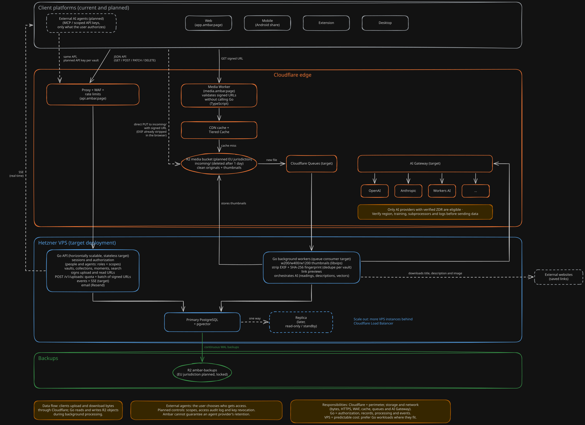

# How Ambar is put together

This page separates the system that runs today from the target architecture for media-heavy storage. Use the [API contract](../reference/api.md) for available routes and the [media storage design](media-storage.md) for the proposed upload and delivery pipeline.

## What runs today

One Bun monorepo holds every surface:

- `apps/web`: the public site (Astro). It hosts the first keep flow and sign-in dialog.
- `apps/app`: the web app (Vite + React Router): moments, collections, canvas and trash.
- `apps/api`: one Go binary using chi and PostgreSQL, behind `https://api.ambar.page`.
- `packages/core`: TypeScript without DOM or React APIs: contracts, validation, limits and platform data.
- `packages/ui`: React components shared by HTML surfaces.

The Go API currently serves health checks and authentication: passwordless email sign-in, Google and GitHub OAuth, sessions, and connected sign-in identities. The media library still uses the mock client. The API does not yet serve upload, moment, vault, search, agent or synchronization endpoints. See the [implemented API routes](../reference/api.md#implemented-routes).

The API stays deliberately flat: `main.go` wires configuration, dependencies and shutdown; `routes.go` mounts middleware and routes; handlers live in `*_handlers.go`; separate code lives in `auth/`, `mail/`, `oauth/` and `migrations/`.

## Target media architecture

The following diagram is a roadmap, not a deployment inventory. Its components and flows remain subject to implementation and the decisions noted below.

| Status | Components and behavior |
| --- | --- |
| Running today | Go API for health and authentication, PostgreSQL auth data, email delivery and configured Google/GitHub sign-in. Vaults and membership, quotas, direct client-to-R2 uploads and photo processing into moments (metadata stripped, WebP copies, duplicates within a vault). The clients don't use these yet. |
| Designed, not built | Clip and PDF processing, reading moments, signed media URLs (previews served by the API behind Cloudflare's cache, originals presigned from R2) and permanent deletion. Moment operations in OpenAPI are design-only. |
| Target or undecided | External queue, AI Gateway and providers, agent credentials/MCP, vector search, SSE, read replicas, load-balanced API instances and backup bucket. These are not current API capabilities. |

The intended split is that Go makes authorization and persistence decisions, while Cloudflare handles large media transfers and edge delivery. Go may read and write R2 objects during background processing. Clients use signed URLs for direct upload and media delivery. The detailed flow and open failure cases are in [Media storage](media-storage.md).

The diagram treats data protection as a design constraint. Ambar will only select AI providers that meet its zero-data-retention (ZDR) requirement. Provider processing region, training use, gateway logging and applicable compliance obligations must be verified against the selected provider and configuration before documentation presents them as guarantees. The current system does not send media to AI providers.

## Design references

The API uses Google AIP guidance selectively for resource naming, standard methods, pagination and versioning; RFC 9457 for errors; and OpenTelemetry field names for logs. Repository documentation follows Diátaxis. See `docs/decisions/` for the recorded choices and their status.
